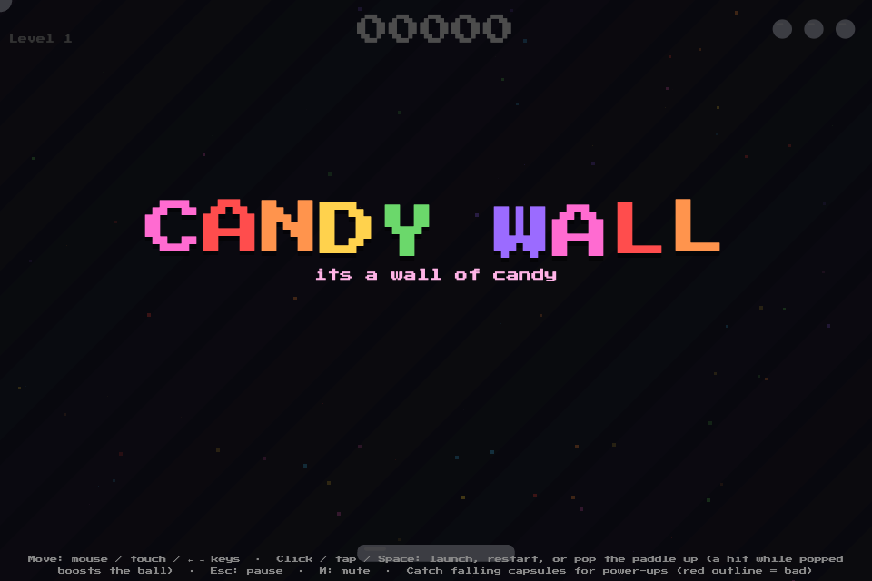
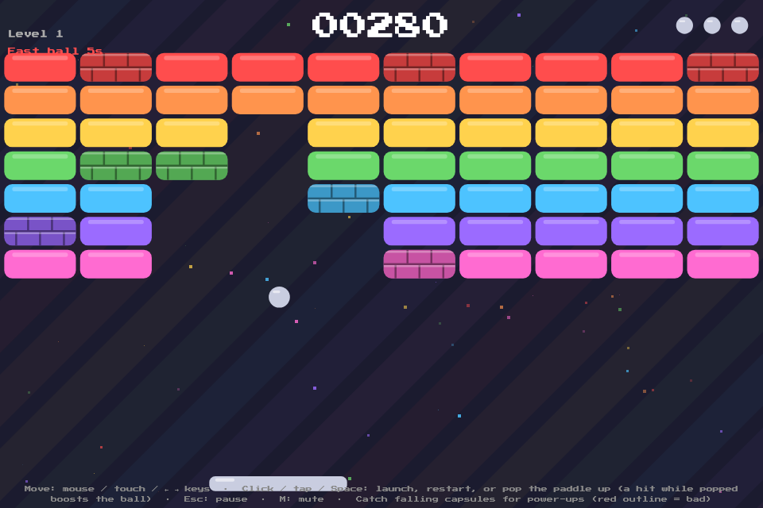
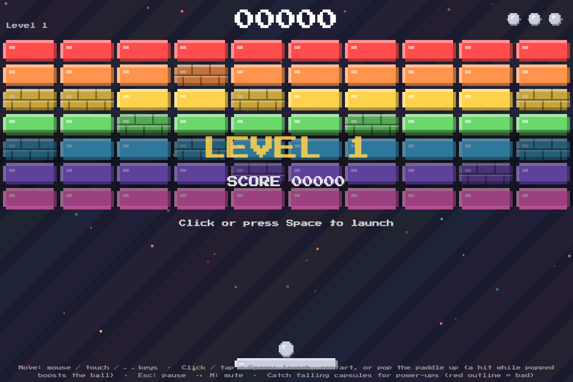
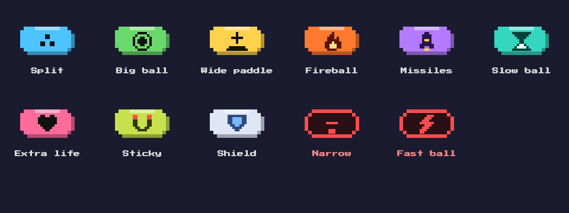

# Candy Wall

It's a wall of candy. A canvas breakout game with 8-bit looks and sound, built with [Vite](https://vite.dev).

**Play:** https://etwilliams.github.io/candy-wall/ (pick Candy Wall, Candy Grid or Candy Drop from the menu). Candy Wall is also directly at `/wall.html`.

<p align="center">
  
</p>

**Also here: Candy Grid.** A drag-and-drop block puzzle in the same 8-bit style, at https://etwilliams.github.io/candy-wall/candygrid.html (locally, `/candygrid.html`). Drag pieces onto the 8x8 grid and fill whole rows or columns to clear them.

**And Candy Drop**, a falling-block stacker with hold, a next queue, a landing ghost and levels, at https://etwilliams.github.io/candy-wall/candydrop.html. Arrow keys move, Up / X and Z rotate, Space hard-drops, C holds. On touch: drag to move, tap to rotate, flick down to hard-drop.

## How to play

<p align="center">
  
</p>

Break every brick to clear the level. You have three balls (lives); lose one when it falls past the paddle. Each level is a little faster, and more bricks need two hits.

| Input | Action |
|---|---|
| Mouse / ← → / drag (touch) | Move the paddle |
| Click / Space / tap (touch) | Launch the ball, or pop the paddle up |
| Esc | Pause |
| M | Mute |

**Touch:** drag left or right anywhere to slide the paddle, and tap to launch or pop. Tapping with a second finger while dragging also pops, so you can boost without letting go.

**Pop shot:** clicking pops the paddle up. A ball hit while the paddle is up is boosted: faster, and it smashes through the first brick it touches. Launching works the same way.

**Tough bricks** (darker, with a brick pattern) take two hits and show cracks after the first.

Clear every brick and a new wall drops in, with the level and your score shown briefly:

<p align="center">
  
</p>

## Power-ups

Bricks sometimes drop a capsule. Catch it with the paddle.

<p align="center">
  
</p>

| Capsule | Effect |
|---|---|
| Split | Every ball becomes three |
| Big ball | Bigger ball for ~10 s |
| Wide paddle | Wider paddle for ~10 s |
| Fireball | Burns through every brick until it hits the top wall |
| Missiles | Each click fires rockets for ~8 s |
| Slow ball | Slower ball for ~10 s |
| Extra life | One more ball (up to 5) |
| Sticky paddle | Paddle catches the ball; click to release with a boosted shot |
| Shield | A line along the bottom saves one miss |

**Power-downs** (red outline) are rarer: **Narrow paddle** and **Fast ball**.

## Development

```bash
npm install
npm run dev      # dev server at http://localhost:5173
npm run build    # production build in dist/
npm run preview  # serve the production build
```

All sound is synthesized with the Web Audio API, so there are no audio files. The pixel font is [Press Start 2P](https://fonts.google.com/specimen/Press+Start+2P) via `@fontsource`.

- `index.html`, `src/launcher.js`, `src/launcher-sound.js`: the game menu and its music
- `wall.html`, `src/main.js`: Candy Wall game logic, drawing and input
- `src/sound.js`: sound effects and music
- `candydrop.html`, `src/candydrop.js`, `src/candydrop-sound.js`: the Candy Drop game
- `candygrid.html`, `src/candygrid.js`, `src/candygrid-sound.js`: the Candy Grid game, built on the shared audio helpers in `sound.js`

## Deployment

Pushes to `main` build and deploy to GitHub Pages through `.github/workflows/deploy.yml`. In the repo's **Settings → Pages**, set the source to **GitHub Actions**.

## License

See [LICENSE](LICENSE).
